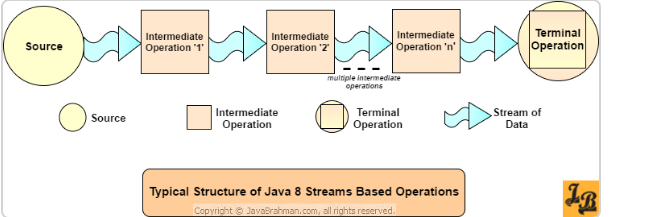
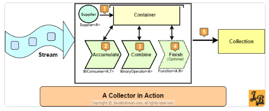
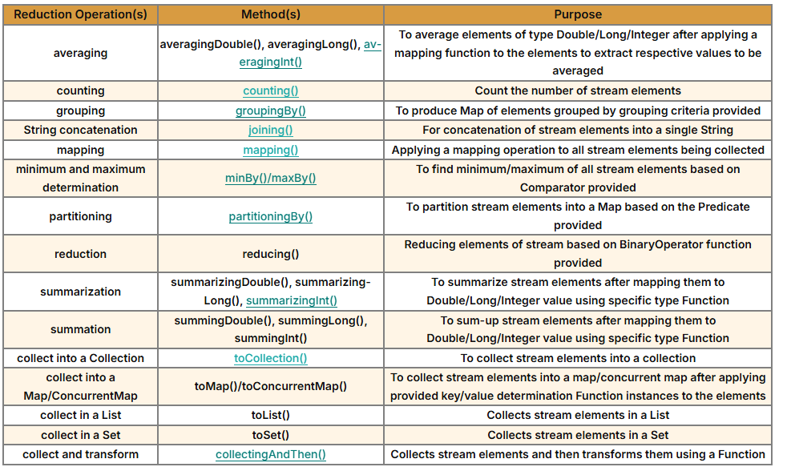
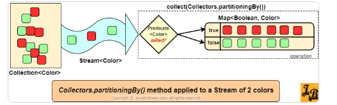
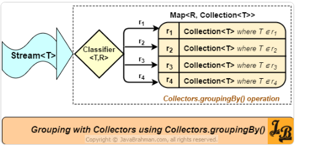
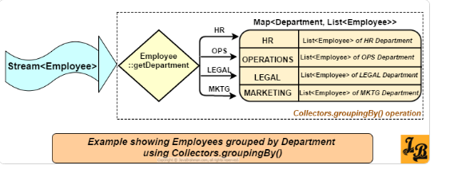

## Stream

Def: sequence of elements supporting sequential and parallel aggregate operations.

### Components of Stream:
1. Source: Collection, Array, I/O channel, generator function.
2. Intermediate operations: it returns a stream i.e. filter, map, sorted, distinct, limit, skip.
3. Terminal operations: it returns final output i.e. forEach, collect, reduce, count, anyMatch, allMatch.



- Stream is Lazy in nature, processing will start only when terminal operation is invoked.

Benefits of Lazy: in below example, Even the iterate() method will generate infinite numbers, but this is aware that we have limit() and will only generate 5 numbers. this is called short-circuiting.

```java
Stream.iterate(0, n->n+2)
        .peek(num -> System.out.println("Peeked at:"+num))
        .limit(5)
        .forEach(System.out::println);
```

### Type of intermediate operations:
1. **Stateless:** Stream data will flow through this one by one (filter, map, distinct, limit, skip).
2. **Stateful:** It will collect all the stream data and then apply these operation(sorted, distinct).

### Ways to create Stream:
1. From Collection: **list.stream()**
2. From Array for primitive type (int, long): **Arrays.stream(array)**
3. Stream.of() method: **Stream.of(1,2,3,4,5)**
4. Stream.iterate() method: **Stream.iterate(0, n->n+2)**, it will take a seed and recursive function.
5. Stream.generate() method: **Stream.generate(Math::random)**, it will take a supplier.

### map() and flatMap():

- map(): to convert the values, it accepts a Function. **employeeList.stream().map(emp -> emp.getName()). collect(toList())**;
- flatMap(): flatten the multi-level stream into a single stream. Example: get first and last name of all the employees. 
```java
 List<String> nameCharList = employeeList.stream()
  	       .map(emp-> emp.getName().split(""))
	       .flatMap(array->Arrays.stream(array))
	       .map(str -> str.toUpperCase()) 
	       .filter(str -> !(str.equals(" ")))
	       .collect(toList());
```

### Filtering and slicing using filter(), distinct(), limit(), skip():

- **filter(predicate):** accept a predicate and return another stream with matching elements.
- **distinct():** return a stream with unique elements, it uses **equals() and hashCode()** method to check for uniqueness.
- **limit(n):** to put the upper limit, it is a short-circuiting intermediate operation.
- **skip(n):** it skip the first n elements and return the rest of the stream.

### Matching and finding using anyMatch(), allMatch(), noneMatch(), findFirst(), findAny():
- all are terminal operations and short-circuiting operation.
- anyMatch(), allMatch(), noneMatch() accept a predicate and return boolean value.
- allMatch(predicate): return true if all element matches the predicate, stop processing is any of element not matches the predicate.
- anyMatch(predicate): return true if any of the element matches the predicate, stop processing if any of the element matches the predicate.
- noneMatch(predicate): return true if none of the element matches the predicate, stop processing if any match found.
- findFirst(): return the first element of the stream, if stream is empty then return Optional.empty().
- findAny(): return any element of the stream, if stream is empty then return Optional.empty().

### Reducing stream using reduce():
soul purpose is to accumulate the stream value in a single value. Example: sum all elements or find maximum.

- reduce(initialValue, (first, second)-> first + second): it take 2 parameters, initial value and a accumulator Function.
- reduce((first, second)-> first + second): it take 1 parameter, a accumulator.

output of one iteration will be passed as first parameter to next.

```java
//Sum of all employee salary
Double totalSalaryExpense = employeeList.stream()
                               .map(emp -> emp.getSalary())
                               .reduce(0.00,(a,b) -> a+b);

//Finding maximum salary employee
Optional<Employee> maxSalaryEmp=employeeList.stream()
        .reduce((Employee a, Employee b) -> a.getSalary() < b.getSalary() ? b:a);
```

### Collectors:
To collect the steam value in a collection.



public Interface Collector<T,A,R>

- T is element type being processed by the Stream and is to be 'collected'
- A is the type of the accumulated result container which keeps on getting elements (of type T) added throughout the 'collecting'
- R is the type of the result container, or the collection, which is returned back as the 'final' output by the collector

- **Supplier** provides empty instance(or instances for parallel collectors) of type A to begin the accumulation of elements
- **Accumulator** uses an instance of A to collect T.
- **Combiner** combines two partial accumulated results of type A to produce a combined instance of A.
- **Finisher** maps A to R using a mapping function.



### Collectors.partioningBy() and groupingBy():

**partioningBy(predicate):** It accepts a predicate and split the stream into 2 parts. one with matching condition and another with non-matching condition. It returns a Map<Boolean, List<T>>.



```java
Map<Boolean,List<Employee>> employeeMap
        = employeeList
          .stream()
          .collect(Collectors.partitioningBy((Employee emp) -> emp.getAge() > 30));
```
- overloaded method: 
  - it accepts another collector as downstream collector and return a Map<Boolean, D> where D is the type of downstream collector.
  - Collector<T, ?, Map<Boolean, D>> partitioningBy(Predicate<? super T> predicate, Collector<? super T, A, D> downstream)

```java
//counting employee with greater and lower age than 30
Map<Boolean,Long> employeeMapCount =
        employeeList.stream()
            .collect(Collectors.partitioningBy(
                (Employee emp) -> (emp.getAge() > 30),
                Collectors.counting()
            ));
```

**groupingBy(classifier):** To divide whole stream into groups based on some criteria. it is same as SQL groupby.
-  classifier is nothing but the Function<T,R>, T is the stream element, and R is the returned value from function and act as key to Map<R, Collection<T>>.





3 overloaded methods of groupingBy():
- **groupingBy(classifier)**
  - Simplest one, accept only a function to map the key.
  - value will be collected in a List<T> by default.
  - public static <T, K> Collector<T, ?, Map<K, List<T>>> **groupingBy**(Function<? super T, ? extends K> **classifier**)

- **groupingBy(classifier, downstream)**
  - Accept another collector to define how to collect the values for each key, in set, list, count, sum, average etc.
  - first method call this with Collectors.toList() as downstream collector.
  - Collector<T, ?, Map<K, D>> **groupingBy**(Function<? super T, ? extends K> **classifier**, Collector<? super T, A, D> **downstream**)

- **groupingBy(classifier, mapFactory, downstream)**
  - Third parameter to define how to create the map, it can be HashMap, TreeMap, LinkedHashMap etc.
  - Collector<T, ?, M> **groupingBy**(Function<? super T, ? extends K> **classifier**, Supplier<M> **mapFactory**, Collector<? super T, A, D> **downstream**)
  - 2nd method call this with new HashMap<>().

```java
//collect employee based on department
Map<Department,List<Employee>> employeeMap
        = employeeList.stream().collect(Collectors.groupingBy(Employee::getDepartment));

//collect employee based on department and store in Set<Employee>
Map<Department,Set<Employee>> employeeMap
        = employeeList.stream()
        .collect(Collectors.groupingBy(Employee::getDepartment, Collectors.toSet()));

//collect employee based on department and store in Set<Employee> and store in TreeMap
Map<Department,Set<Employee>> employeeMap
        = employeeList.stream()
        .collect(Collectors.groupingBy(Employee::getDepartment, TreeMap::new, Collectors.toSet()));
```

### Counting(): 
it will return the count of elements in stream. **Collectors.counting()**, we can use this as downstream collector in groupingBy() or partitioningBy().

### Collectors.averagingInt(), Collectors.averagingLong() and Collectors.averagingDouble()

- public static <T> Collector<T, ?, Double> averagingInt(ToIntFunction<? super T> mapper)
- public static <T> Collector<T, ?, Double> averagingLong(ToLongFunction<? super T> mapper)
- public static <T> Collector<T, ?, Double> averagingDouble(ToDoubleFunction<? super T> mapper)

- All 3 accepts a function to convert the elements into the int/long/double.
- All will return double.

```java
//Using Collectors.averagingInt()
Double avgAge = employeeList
        .stream()
        .collect(Collectors.averagingInt(Employee::getAge));

    //Using Collectors.averagingLong()
    Double avgLeaves = employeeList
        .stream()
        .collect(Collectors.averagingLong(Employee::getLeaves));

    //Using Collectors.averagingDouble()
    Double avgSalary = employeeList
        .stream()
        .collect(Collectors.averagingDouble(Employee::getSalary));
```

### Collectors.collectingAndThen
- It accept a collector and a finisher function to transform the result of the collector into another type.
- public static<T,A,R,RR> Collector<T,A,RR> collectingAndThen(Collector<T,A,R> downstream, Function<R,RR> finisher)

```java
//Finding maximum salary employee and return the name of employee
String maxSalaryEmp = employeeList.stream().collect(
        Collectors.collectingAndThen(
            Collectors.maxBy(Comparator.comparing(Employee::getSalary)),
            (Optional<Employee> emp)-> emp.isPresent() ? emp.get().getName() : "none") );
```
### min and max using minBy() and maxBy():
- Predefined Collectors returned by Collectors.maxBy()/Collectors.minBy() methods
- it takes a comparator as argument and return Optional<T>.
- Internally, these collectors delegate their tasks to the 'reducing collector' with the calls reducing(BinaryOperator.maxBy(comparator)) and reducing(BinaryOperator.minBy(comparator)

```java
//Finding maximum salary employee
Optional<Employee> maxSalaryEmp = 
            employeeList.stream()
            .collect(Collectors.maxBy(Comparator.comparing(Employee::getSalary)));

//Finding minimum age employee
Optional<Employee> minAgeEmp =    
            employeeList.stream()
            .collect(Collectors.minBy(Comparator.comparing(Employee::getAge)));
```

**range(), rangeClosed()** methods of IntStream, LongStream:

- Both are use to generate a IntStream or LongStream with a range of values.
- range(start, end): end is not inclusive.
- rangeClosed(start, end): end is inclusive.
- number increase by 1.
```java
IntStream.range(1, 10).forEach(i -> System.out.print(i + " "));
```


