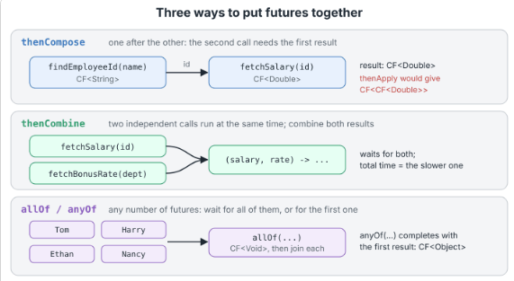

## CompletableFuture
- Introduced in java-8 to overcome the limitations of Future.
- Both CompletableFuture<T> implements Future<T> and CompletionStage<T>
- Both are designed to monitor the task which completes later, output of task submitted to executor service..


### Limitations of Future<T>
- **Blocking  only:** get() blocks the current thread until result is ready, No way to say "When result arrives do this".
- **No Chaining:** can't combine multiple steps to use the result of previous step, have to handle manually after getting result from get().
- **No Error Pipeline:** exception only appear if we call get().
- No manual Completion.

### Creation of CompletableFuture.
- **supplyAsync(Function<T,R>, Executor(optional))**: completes with a value of type R, uses ForkJoinPool.commonPool() as default pool.
- **runAsync(Runnable, Executor(optional))**: Completes with null.
- **new CompletableFuture<>()**: empty CompletableFuture.

### Attach Next Step
- **thenApply(Function<T,U>)**: returning `CompletableFuture<U>`
- **thenAccept(Consumer<T>)**: returning `CompletableFuture<void>`
- **thenRun**(Runnable): just run a action after completion, e.g. intimation of task completion by logging.

### Get Result
- **join()**: throws unchecked exception, suitable for lambda.
- **get()**: throws checked exception.

<details>
<summary>View Java Code</summary>

```java
public class CompletableFutureBasics {
  // Imitates a slow lookup, such as a database query or a remote call
  static Employee findEmployee(String id) {
    sleep(200);
    return new Employee("Tom Jones", 5200);
  }

  static void sleep(long millis) {
    try {
      Thread.sleep(millis);
    } catch (InterruptedException e) {
      Thread.currentThread().interrupt();
    }
  }

  public static void main(String[] args) throws Exception {
    // 1. Start a task asynchronously and collect the result later
    CompletableFuture<Employee> lookup =
        CompletableFuture.supplyAsync(() -> findEmployee("E-1001"));
    System.out.println("1. Lookup started, done yet? " + lookup.isDone()); //false
    System.out.println("   Found: " + lookup.join().getName()); //Tom Jones

    // 2. A pipeline: each stage runs when the previous one completes
    CompletableFuture<String> annual = CompletableFuture
        .supplyAsync(() -> findEmployee("E-1001"))
        .thenApply(e -> e.getMonthlySalary() * 12)
        .thenApply(salary -> String.format("Annual salary: %.2f", salary)); // return a String
    System.out.println("2. " + annual.join()); 

    // 3. thenAccept and thenRun end a pipeline with side effects
    CompletableFuture<Void> done = CompletableFuture
        .supplyAsync(() -> findEmployee("E-1001"))
        .thenAccept(e -> System.out.println("3. Sending payslip to " + e.getName()))
        .thenRun(() -> System.out.println("   Payslip run finished"));
    done.join();

    // 4. A future completed by hand, from another thread
    CompletableFuture<String> approval = new CompletableFuture<>();
    new Thread(() -> {
      sleep(100);
      approval.complete("approved");
    }).start();
    System.out.println("4. Manager decision: " + approval.get(1, TimeUnit.SECONDS));

    // 5. Running the task in our own thread pool instead of the common pool
    ExecutorService payrollPool = Executors.newFixedThreadPool(2);
    try {
      String name = CompletableFuture
          .supplyAsync(() -> findEmployee("E-1001").getName(), payrollPool)
          .thenApply(String::toUpperCase)
          .join();
      System.out.println("5. With our own pool: " + name);
    } finally {
      payrollPool.shutdown();
    }

    // 6. An already completed future, useful for caches and tests
    CompletableFuture<String> cached = CompletableFuture.completedFuture("Tom Jones");
    System.out.println("6. Completed at once? " + cached.isDone()
        + ", value: " + cached.join());
  }
}
```
</details>

### Combine CompletableFuture
- **thenCompose**(`Function<T,CompletionStage<U>>` fn): sequential, for dependent call, it takes only a Function as argument, returns  CompletableFuture<`CompletableFuture<U>`>
- **thenCombine**(`CompletionStage<U> other, BiFunction<T,U,R>` bifn): parallel, for independent calls, it takes another future and a bifunction, which will be called with result of both futures.

### allOf() and anyOf() - any number of futures
- allOf(CF<?> ...cfs): it will complete when all the cfs are completed with void result as all can have different type.
- anyOf(CF<?> ...cfs): completes on completion of any future with that result.



### Error Handling
- if a stage throw exception, all the later stages will skip.
- The exception travels down the pipeline to stage which handles the exceptions or join/get call.
- **exceptionally**(Function<Throwable, T> fn): calls only when exception occurs.
- **handle**(BiFunction<T, Throwable, U> fn): always called, either exception or value as null.
- **whenComplete**(BiConsumer<T, Throwable> action): always called but cant change the value,only for logging purpose.
- **completeExceptionally**(Throwable ex): manual exception.

<details>
<summary>View Java Code</summary>

```java
public class CombiningFutures {

  static final Map<String, String> IDS = new HashMap<>();
  static final Map<String, Double> SALARIES = new HashMap<>();
  static {
    IDS.put("Tom Jones", "E-1001");
    IDS.put("Harry Major", "E-1002");
    IDS.put("Ethan Hardy", "E-1003");
    IDS.put("Nancy Smith", "E-1004");
    SALARIES.put("E-1001", 5200.0);
    SALARIES.put("E-1002", 4100.0);
    SALARIES.put("E-1003", 6300.0);
    SALARIES.put("E-1004", 5800.0);
  }

  // Three slow, asynchronous lookups
  static CompletableFuture<String> findEmployeeId(String name) {
    return CompletableFuture.supplyAsync(() -> {
      sleep(100);
      String id = IDS.get(name);
      if (id == null) {
        throw new IllegalArgumentException("No employee named " + name);
      }
      return id;
    });
  }

  static CompletableFuture<Double> fetchSalary(String id) {
    return CompletableFuture.supplyAsync(() -> {
      sleep(150);
      return SALARIES.get(id);
    });
  }

  static CompletableFuture<Double> fetchBonusRate(String department) {
    return CompletableFuture.supplyAsync(() -> {
      sleep(150);
      return 0.10;                       // the same rate for every department here
    });
  }

  static void sleep(long millis) {
    try {
      Thread.sleep(millis);
    } catch (InterruptedException e) {
      Thread.currentThread().interrupt();
    }
  }

  public static void main(String[] args) {
    // 1. thenCompose: the second call needs the result of the first
    CompletableFuture<Double> salary = findEmployeeId("Tom Jones").thenCompose(id -> fetchSalary(id));
    System.out.println("1. thenCompose  -> salary " + salary.join());

    // 2. thenCombine: two independent calls, both results needed
    CompletableFuture<Double> bonus = fetchSalary("E-1001").thenCombine(fetchBonusRate("Finance"), (pay, rate) -> pay * rate);
    System.out.println("2. thenCombine  -> bonus " + bonus.join());

    // 3. allOf: start many calls, wait for all, collect the results
    List<String> team = Arrays.asList("Tom Jones", "Harry Major", "Ethan Hardy", "Nancy Smith");
    List<CompletableFuture<Double>> calls = team.stream()
        .map(name -> findEmployeeId(name).thenCompose(CombiningFutures::fetchSalary))
        .collect(Collectors.toList());
    
    CompletableFuture<Void> all = CompletableFuture.allOf(calls.toArray(new CompletableFuture<?>[0]));
    List<Double> salaries = all
        .thenApply(v -> calls.stream()
            .map(CompletableFuture::join)
            .collect(Collectors.toList()))
        .join();
    System.out.println("3. allOf        -> " + salaries);

    // 4. A failure skips the later stages; exceptionally() supplies a default
    double unknown = findEmployeeId("Deborah Sprightly")
        .thenCompose(CombiningFutures::fetchSalary)
        .thenApply(pay -> pay * 12)
        .exceptionally(ex -> {
          System.out.println("4. exceptionally caught " + ex.getClass().getSimpleName() + " caused by: " + ex.getCause().getMessage());
          return 0.0;
        })
        .join();
    System.out.println("   annual salary used: " + unknown);

    // 5. handle(): one method for both outcomes
    String report = findEmployeeId("Deborah Sprightly")
        .handle((id, ex) -> ex == null ? "found " + id : "not found")
        .join();
    System.out.println("5. handle       -> " + report);

    // 6. whenComplete(): look at the outcome without changing it
    CompletableFuture<String> logged = findEmployeeId("Harry Major")
        .whenComplete((id, ex) -> System.out.println("6. whenComplete saw " + id));
    System.out.println("   result still: " + logged.join());

    // 7. join() rethrows the failure, wrapped in an unchecked CompletionException
    try {
      findEmployeeId("Deborah Sprightly").join();
    } catch (CompletionException e) {
      System.out.println("7. join threw CompletionException, cause: "
          + e.getCause().getClass().getSimpleName());
    }
  }
}
```
</details>

## Stream

Def: sequence of elements supporting sequential and parallel aggregate operations.

### Components of Stream:
1. Source: Collection, Array, I/O channel, generator function.
2. Intermediate operations: it returns a stream i.e. filter, map, sorted, distinct, limit, skip.
3. Terminal operations: it returns final output i.e. forEach, collect, reduce, count, anyMatch, allMatch.


- Stream is Lazy in nature, processing will start only when terminal operation is invoked.

Benefits of Lazy: in below example, Even the iterate() method will generate infinite numbers, but this is aware that we have limit() and will only generate 5 numbers. this is called short-circuiting.

```java
Stream.iterate(0, n->n+2)
        .peek(num -> System.out.println("Peeked at:"+num))
        .limit(5)
        .forEach(System.out::println);
```

### Type of intermediate operations:
1. **Stateless:** Process the element as independent (filter, map, flatmap, peek).
2. **Stateful:** It depends on the previously processed element to process the current element, so maintain the state of all processed element(sorted, distinct, limit, skip).

### Ways to create Stream:
1. From Collection: **list.stream()**
2. From Array for primitive type (int, long): **Arrays.stream(array)**
3. Stream.of() method: **Stream.of(1,2,3,4,5)**
4. Stream.iterate() method: **Stream.iterate(0, n->n+2)**, it will take a seed and recursive function.
5. Stream.generate() method: **Stream.generate(Math::random)**, it will take a supplier.

### map() and flatMap():

- map(): to convert the values, it accepts a Function. **employeeList.stream().map(emp -> emp.getName()). collect(toList())**;
- flatMap(): flatten the multi-level stream into a single stream. Example: get first and last name of all the employees. 
```java
 List<String> nameCharList = employeeList.stream()
  	       .map(emp-> emp.getName().split(""))
	       .flatMap(array->Arrays.stream(array))
	       .map(str -> str.toUpperCase()) 
	       .filter(str -> !(str.equals(" ")))
	       .collect(toList());
```

### Filtering and slicing using filter(), distinct(), limit(), skip():

- **filter(predicate):** accept a predicate and return another stream with matching elements.
- **distinct():** return a stream with unique elements, it uses **equals() and hashCode()** method to check for uniqueness.
- **limit(n):** to put the upper limit, it is a short-circuiting intermediate operation.
- **skip(n):** it skip the first n elements and return the rest of the stream.

### Matching and finding using anyMatch(), allMatch(), noneMatch(), findFirst(), findAny():
- all are terminal operations and short-circuiting operation.
- anyMatch(), allMatch(), noneMatch() accept a predicate and return boolean value.
- allMatch(predicate): return true if all element matches the predicate, stop processing is any of element not matches the predicate.
- anyMatch(predicate): return true if any of the element matches the predicate, stop processing if any of the element matches the predicate.
- noneMatch(predicate): return true if none of the element matches the predicate, stop processing if any match found.
- findFirst(): return the first element of the stream, if stream is empty then return Optional.empty().
- findAny(): return any element of the stream, if stream is empty then return Optional.empty().

### Reducing stream using reduce():
soul purpose is to accumulate the stream value in a single value. Example: sum all elements or find maximum.

- reduce(initialValue, (first, second)-> first + second): it take 2 parameters, initial value and a accumulator Function.
- reduce((first, second)-> first + second): it take 1 parameter, a accumulator.

output of one iteration will be passed as first parameter to next.

```java
//Sum of all employee salary
Double totalSalaryExpense = employeeList.stream()
                               .map(emp -> emp.getSalary())
                               .reduce(0.00,(a,b) -> a+b);

//Finding maximum salary employee
Optional<Employee> maxSalaryEmp=employeeList.stream()
        .reduce((Employee a, Employee b) -> a.getSalary() < b.getSalary() ? b:a);
```

### Collectors:
To collect the steam value in a collection.


public Interface Collector<T,A,R>

- T is element type being processed by the Stream and is to be 'collected'
- A is the type of the accumulated result container which keeps on getting elements (of type T) added throughout the 'collecting'
- R is the type of the result container, or the collection, which is returned back as the 'final' output by the collector

- **Supplier** provides empty instance(or instances for parallel collectors) of type A to begin the accumulation of elements
- **Accumulator** uses an instance of A to collect T.
- **Combiner** combines two partial accumulated results of type A to produce a combined instance of A.
- **Finisher** maps A to R using a mapping function.


### Collectors.partioningBy() and groupingBy():

**partioningBy(predicate):** It accepts a predicate and split the stream into 2 parts. one with matching condition and another with non-matching condition. It returns a Map<Boolean, List<T>>.


```java
Map<Boolean,List<Employee>> employeeMap
        = employeeList
          .stream()
          .collect(Collectors.partitioningBy((Employee emp) -> emp.getAge() > 30));
```
- overloaded method: 
  - it accepts another collector as downstream collector and return a Map<Boolean, D> where D is the type of downstream collector.
  - Collector<T, ?, Map<Boolean, D>> partitioningBy(Predicate<? super T> predicate, Collector<? super T, A, D> downstream)

```java
//counting employee with greater and lower age than 30
Map<Boolean,Long> employeeMapCount =
        employeeList.stream()
            .collect(Collectors.partitioningBy(
                (Employee emp) -> (emp.getAge() > 30),
                Collectors.counting()
            ));
```

**groupingBy(classifier):** To divide whole stream into groups based on some criteria. it is same as SQL groupby.
-  classifier is nothing but the Function<T,R>, T is the stream element, and R is the returned value from function and act as key to Map<R, Collection<T>>.


3 overloaded methods of groupingBy():
- **groupingBy(classifier)**
  - Simplest one, accept only a function to map the key.
  - value will be collected in a List<T> by default.
  - public static <T, K> Collector<T, ?, Map<K, List<T>>> **groupingBy**(Function<? super T, ? extends K> **classifier**)

- **groupingBy(classifier, downstream)**
  - Accept another collector to define how to collect the values for each key, in set, list, count, sum, average etc.
  - first method call this with Collectors.toList() as downstream collector.
  - Collector<T, ?, Map<K, D>> **groupingBy**(Function<? super T, ? extends K> **classifier**, Collector<? super T, A, D> **downstream**)

- **groupingBy(classifier, mapFactory, downstream)**
  - Third parameter to define how to create the map, it can be HashMap, TreeMap, LinkedHashMap etc.
  - Collector<T, ?, M> **groupingBy**(Function<? super T, ? extends K> **classifier**, Supplier<M> **mapFactory**, Collector<? super T, A, D> **downstream**)
  - 2nd method call this with new HashMap<>().

```java
//collect employee based on department
Map<Department,List<Employee>> employeeMap
        = employeeList.stream().collect(Collectors.groupingBy(Employee::getDepartment));

//collect employee based on department and store in Set<Employee>
Map<Department,Set<Employee>> employeeMap
        = employeeList.stream()
        .collect(Collectors.groupingBy(Employee::getDepartment, Collectors.toSet()));

//collect employee based on department and store in Set<Employee> and store in TreeMap
Map<Department,Set<Employee>> employeeMap
        = employeeList.stream()
        .collect(Collectors.groupingBy(Employee::getDepartment, TreeMap::new, Collectors.toSet()));
```

### Counting(): 
it will return the count of elements in stream. **Collectors.counting()**, we can use this as downstream collector in groupingBy() or partitioningBy().

### Collectors.averagingInt(), Collectors.averagingLong() and Collectors.averagingDouble()

- public static <T> Collector<T, ?, Double> averagingInt(ToIntFunction<? super T> mapper)
- public static <T> Collector<T, ?, Double> averagingLong(ToLongFunction<? super T> mapper)
- public static <T> Collector<T, ?, Double> averagingDouble(ToDoubleFunction<? super T> mapper)

- All 3 accepts a function to convert the elements into the int/long/double.
- All will return double.

```java
//Using Collectors.averagingInt()
Double avgAge = employeeList
        .stream()
        .collect(Collectors.averagingInt(Employee::getAge));

    //Using Collectors.averagingLong()
    Double avgLeaves = employeeList
        .stream()
        .collect(Collectors.averagingLong(Employee::getLeaves));

    //Using Collectors.averagingDouble()
    Double avgSalary = employeeList
        .stream()
        .collect(Collectors.averagingDouble(Employee::getSalary));
```

### Collectors.collectingAndThen
- It accept a collector and a finisher function to transform the result of the collector into another type.
- public static<T,A,R,RR> Collector<T,A,RR> collectingAndThen(Collector<T,A,R> downstream, Function<R,RR> finisher)

```java
//Finding maximum salary employee and return the name of employee
String maxSalaryEmp = employeeList.stream().collect(
        Collectors.collectingAndThen(
            Collectors.maxBy(Comparator.comparing(Employee::getSalary)),
            (Optional<Employee> emp)-> emp.isPresent() ? emp.get().getName() : "none") );
```
### min and max using minBy() and maxBy():
- Predefined Collectors returned by Collectors.maxBy()/Collectors.minBy() methods
- it takes a comparator as argument and return Optional<T>.
- Internally, these collectors delegate their tasks to the 'reducing collector' with the calls reducing(BinaryOperator.maxBy(comparator)) and reducing(BinaryOperator.minBy(comparator)

```java
//Finding maximum salary employee
Optional<Employee> maxSalaryEmp = 
            employeeList.stream()
            .collect(Collectors.maxBy(Comparator.comparing(Employee::getSalary)));

//Finding minimum age employee
Optional<Employee> minAgeEmp =    
            employeeList.stream()
            .collect(Collectors.minBy(Comparator.comparing(Employee::getAge)));
```

**range(), rangeClosed()** methods of IntStream, LongStream:

- Both are use to generate a IntStream or LongStream with a range of values.
- range(start, end): end is not inclusive.
- rangeClosed(start, end): end is inclusive.
- number increase by 1.
```java
IntStream.range(1, 10).forEach(i -> System.out.print(i + " "));
```


