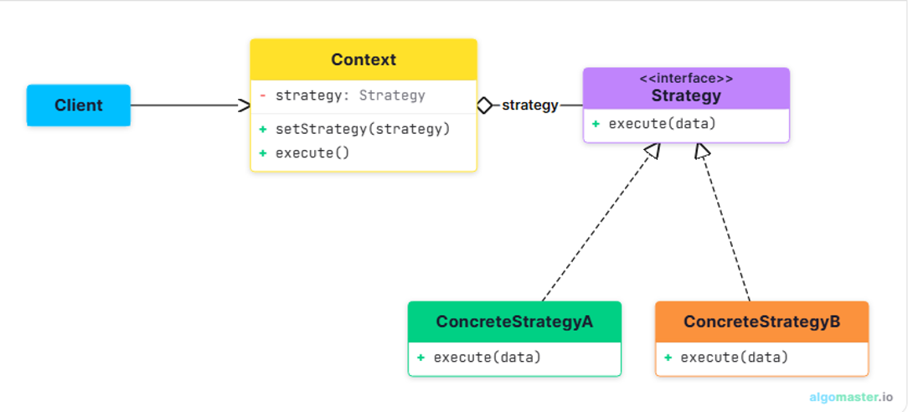
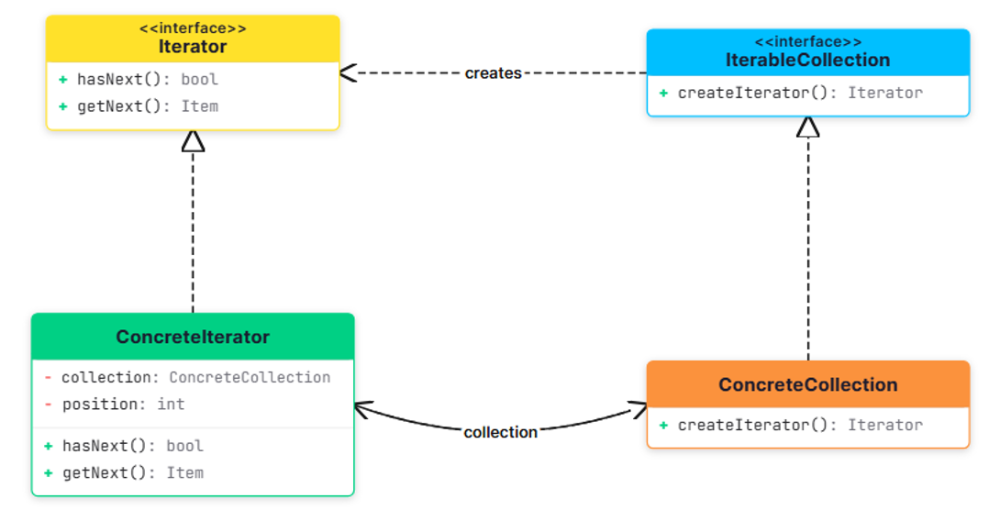
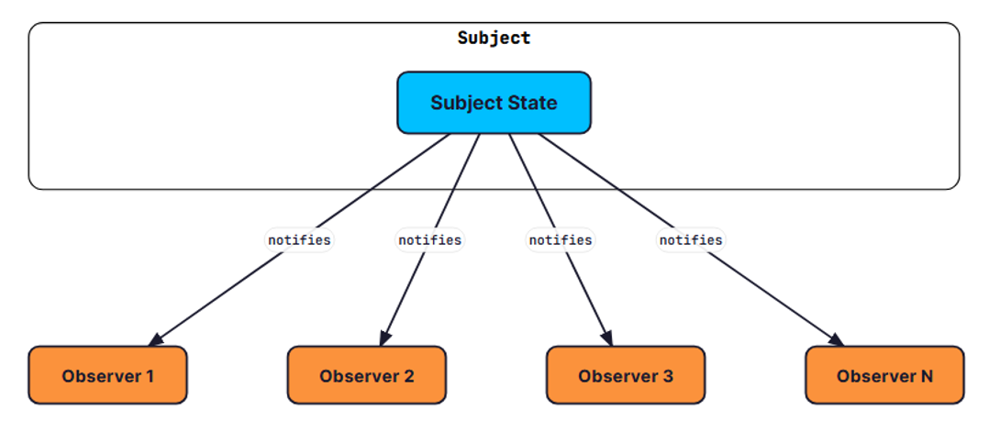
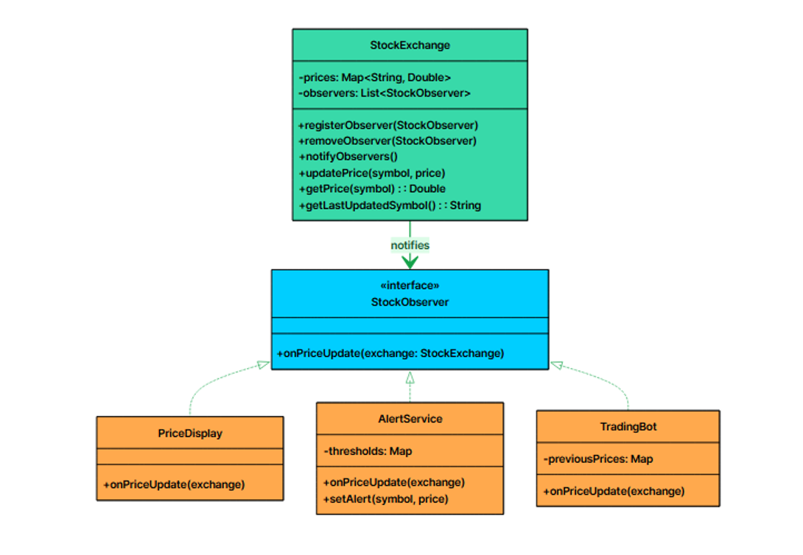
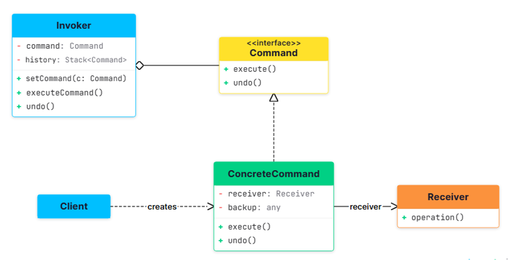
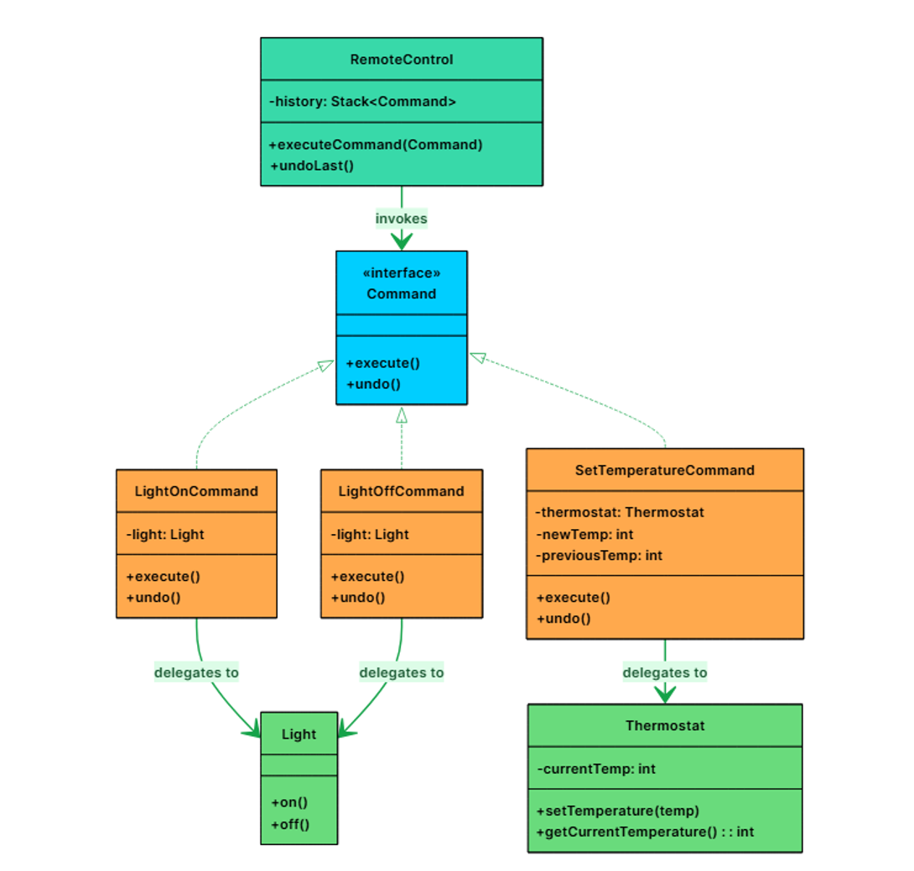
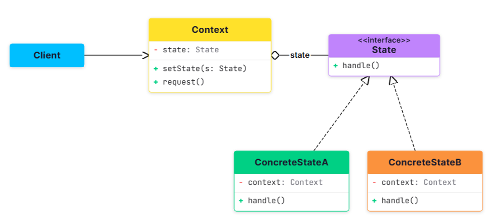
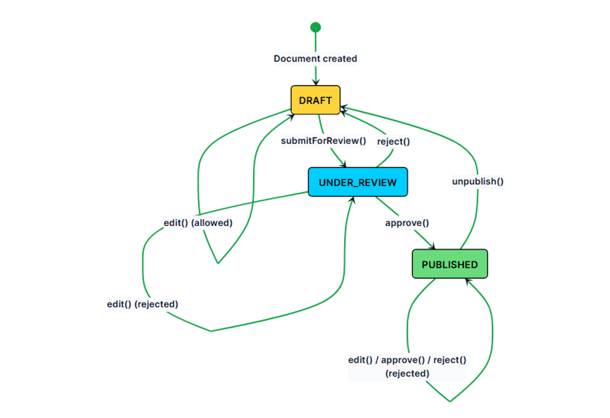
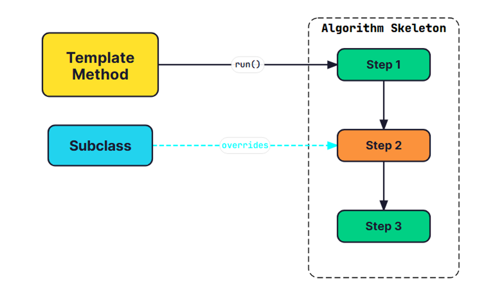
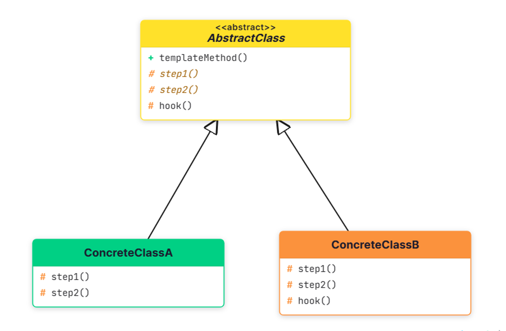

# Design Patterns
## Table of Contents

- [Strategy](#Strategy-Design-Pattern)
- [Iterator](#Iterator-Design-Pattern)
- [Observer](#Observer-Design-Pattern)
- [Command](#Command-Design-Pattern)
- [State](#State-Design-Pattern)
- [Template Method](#Template-Method-Design-Pattern)

## Strategy Design Pattern
This pattern becomes valuable when:
- You have multiple ways to perform the same operation, and the choice might change at runtime
- You want to avoid bloated conditional statements that select between different behaviors
- You need to isolate algorithm-specific data and logic from the code that uses it
- Different clients might need different algorithms for the same task
```text
The Strategy Pattern defines a family of algorithms, encapsulates each one, and makes them interchangeable. 
Strategy lets the algorithm vary independently from clients that use it.
```
Two characteristics define the pattern: Encapsulation of algorithms and Runtime interchangeability
Explain the purpose of the project and the problem it solves.


Practical Example: Payment Processing
Let us work through a second example to reinforce the pattern. This time, we are building a payment processing system that supports multiple payment methods: credit card, PayPal, and cryptocurrency. Each method has a different processing flow, but the checkout service should not care which one is being used.


```java
//Strategy Interface
public interface PaymentProcessor {
    public void processPayment(double amount);
}

//Concrete Strategy-1
public class CreditCardPayment implements PaymentProcessor {
    private CardDetails cardDetails;
    @Override
    public void processPayment(double amount) {
        if(cardDetails==null){
            throw new IllegalArgumentException("Card details cannot be null");
        }
        System.out.println("Processing credit card payment of amount: " + amount);
        System.out.println("Card Number: " + cardDetails.getCardNumber());
        System.out.println("Card Holder: " + cardDetails.getCardHolder());
    }
}
//concrete Strategy-2
public class PaypalPayment implements PaymentProcessor {
    @Override
    public void processPayment(double amount) {
        System.out.println("Processing PayPal payment of amount: " + amount);
    }
}
//concrete Strategy-3
public class StripePayment implements PaymentProcessor {
    @Override
    public void processPayment(double amount) {
        System.out.println("Processing Stripe payment of amount: " + amount);
    }
}
//concrete Strategy-4
public class UpiPayment implements PaymentProcessor {
    @Override
    public void processPayment(double amount) {
        System.out.println("Processing UPI payment of amount: " + amount);
    }
}
```
```java
//service that need to change the strategy dynamically
public class CheckoutService {
    private PaymentProcessor paymentProcessor;

    public CheckoutService(PaymentProcessor paymentProcessor) {
        this.paymentProcessor = paymentProcessor;
    }

    public void checkout(double amount) {
        paymentProcessor.processPayment(amount);
    }
}
```
```java
public class Client {
    public static void main(String[] args) {
        // Create a CheckoutService with PaypalPayment strategy
        PaymentProcessor paypalPayment = new PaypalPayment();
        CheckoutService checkoutService = new CheckoutService(paypalPayment);

        // Process payment using PaypalPayment strategy
        checkoutService.checkout(100.0);

        // Change the strategy to CreditCardPayment
        PaymentProcessor creditCardPayment = new CreditCardPayment(new CardDetails("446646","pk",2443));
        checkoutService.setPaymentProcessor(creditCardPayment);

        // Process payment using CreditCardPayment strategy
        checkoutService.checkout(200.0);
    }
}
```
## Iterator Design Pattern
It’s particularly useful in situations where:
- You need to traverse a collection (like a list, tree, or graph) in a consistent and flexible way.
- You want to support multiple ways to iterate (e.g., forward, backward, filtering, or skipping elements).
- You want to decouple traversal logic from collection structure, so the client doesn't depend on the internal representation.
```text
The Iterator Pattern defines a separate object, the iterator, that encapsulates the details of traversing a collection.
Instead of exposing its internal structure, the collection provides an iterator that clients use to access elements sequentially.
```
Two characteristics define the pattern: Separation of traversal from storage and Multiple independent traversals



Practical Example: Notification System
Let us work through a second example to reinforce the pattern in a different domain. We are building a notification system where a NotificationCenter stores notifications of different types: email, SMS, and push. We need iterators that can traverse all notifications, filter by type, and show only unread notifications.


```java
public enum NotificationType {
    EMAIL, SMS, PUSH_NOTIFICATION;
}
//pojo
public class Notification {
    private String message;
    private NotificationType type;
    private boolean isRead=false;
}
```
```java
// A Contract for collection.
public interface Iterable<T> {
    Iterator<T> emailIterator();
    Iterator<T> smsIterator();
    Iterator<T> unreadIterator();
}

// Concrete collection class
public class NotificationCenter implements Iterable<Notification> {
    private List<Notification> notifications = new ArrayList<>();

    @Override
    public Iterator<Notification> emailIterator() {
        return new EmailIterator(this);
    }

    @Override
    public Iterator<Notification> smsIterator() {
        return new SMSIterator(this);
    }

    @Override
    public Iterator<Notification> unreadIterator() {
        return new UnreadIterator(this);
    }

    public int getSize(){
        return notifications.size();
    }

    public Notification getNotification(int index){
        return notifications.get(index);
    }

    public void addNotification(Notification notification){
        notifications.add(notification);
    }
}
```
```java
// Iterator contract
public interface Iterator<T> {
    boolean hasNext();
    T next();
}

// Concrete iterator class-1
public class EmailIterator implements Iterator<Notification> {
    private final NotificationCenter center;
    private int currentIndex = 0;

    public EmailIterator(NotificationCenter center){
        this.center = center;
        currentIndex = findNextIndex();
    }

    @Override
    public boolean hasNext() {
        return currentIndex<center.getSize();
    }

    @Override
    public Notification next() {
        Notification nextElement = center.getNotification(currentIndex++);
        currentIndex = findNextIndex();
        return nextElement;
    }

    private int findNextIndex(){
        for(int i=currentIndex;i<center.getSize();i++){
            if(EMAIL.equals(center.getNotification(i).getType())){
                return i;
            }
        }

        return center.getSize();
    }
}

// Concrete iterator class-2
public class SMSIterator implements Iterator<Notification> {
    private final NotificationCenter center;
    private int currentIndex = 0;

    public SMSIterator(NotificationCenter center){
        this.center = center;
        currentIndex = findNextIndex();
    }
    @Override
    public boolean hasNext() {
        return currentIndex<center.getSize();
    }

    @Override
    public Notification next() {
        Notification nextElement = center.getNotification(currentIndex++);
        currentIndex = findNextIndex();
        return nextElement;
    }

    private int findNextIndex(){
        for(int i=currentIndex;i<center.getSize();i++){
            if(SMS.equals(center.getNotification(i).getType())){
                return i;
            }
        }

        return center.getSize();
    }
}
// Concrete iterator class-3
public class UnreadIterator implements Iterator<Notification> {
    private final NotificationCenter center;
    private int currentIndex = 0;

    public UnreadIterator(NotificationCenter center){
        this.center = center;
    }
    @Override
    public boolean hasNext() {
        return currentIndex< center.getSize();
    }

    @Override
    public Notification next() {
        Notification nextElement = center.getNotification(currentIndex++);
        for(int i=currentIndex;i<center.getSize();i++){
            if(!center.getNotification(i).isRead()){
                currentIndex = i;
                return nextElement;
            }
        }
        return nextElement;
    }
}
```
```java
public class Client {
    public static void main(String[] args) {
        NotificationCenter center = new NotificationCenter();

        center.addNotification(new Notification("email1",EMAIL,false));
        center.addNotification(new Notification("email2",EMAIL,false));
        center.addNotification(new Notification("email3",EMAIL,true));

        center.addNotification(new Notification("sms1",SMS,false));
        center.addNotification(new Notification("sms2",SMS,false));

        Iterator<Notification> smsIterator = center.smsIterator();
        while(smsIterator.hasNext()) {
            Notification notification = smsIterator.next();
            System.out.println(notification);
        }

        Iterator<Notification> unreadEmailIterator = center.unreadIterator();
        while(unreadEmailIterator.hasNext()) {
            Notification notification = unreadEmailIterator.next();
            System.out.println(notification);
        }
    }
}

```

## Observer Design Pattern


This pattern shines in scenarios where:
- You have multiple parts of the system that need to react to a change in one central component.
- You want to decouple the publisher of data from the subscribers who react to it.
- You need a dynamic, event-driven communication model without hardcoding who is listening to whom.
```text
The Observer Design Pattern provides a clean and flexible solution to the problem of broadcasting
changes from one central object (the Subject) to many dependent objects (the Observers) all while keeping them loosely coupled.
```
Two characteristics define the pattern: One-to-many notification and Loose coupling between subject and observers


**Practical Example:** Stock Price Ticker
Let us work through a second example to reinforce the pattern. This time, we are building a stock price notification system. A StockExchange subject publishes price updates for stocks.
Multiple observers react to these updates: a PriceDisplay shows current prices, an AlertService notifies traders when prices cross thresholds, and a TradingBot executes trades based on price movements.



```java
public enum EventType {
    STOCK_PRICE_UPDATE, STOCK_REGISTRATION, STOCK_DELISTING;
}
public class StockEvent {
    private String stockName;
    private double stockPrice;
    private EventType eventType;
}
```
```java
//subject interface
public interface StockExchange {
    void registerObserver(StockObserver observer);
    void removeObserver(StockObserver observer);
    void notifyObservers(StockEvent event);
    void registerStock(String stockName, double price);
    void updateStockPrice(String stockName, double price);
    void unregisterStock(String stockName);
    Map<String,Double> getStockPrices();
}

//this should be a singleton class, but for simplicity, we are not implementing singleton pattern here
@Data
public class StockExchangeImpl implements StockExchange {
    private List<StockObserver> observers = new ArrayList<>();
    private Map<String, Double> stockPrices = new HashMap<>();

    @Override
    public void registerObserver(StockObserver observer) {
        observers.add(observer);
    }

    @Override
    public void removeObserver(StockObserver observer) {
        observers.remove(observer);
    }

    @Override
    public void notifyObservers(StockEvent event) {
        observers.forEach(obs -> obs.processStockEvent(event));
    }

    @Override
    public void registerStock(String stockName, double price) {
        stockPrices.put(stockName,price);

        //notify: notify observers when a new stock is registered
        StockEvent stockEvent = new StockEvent(stockName, price, EventType.STOCK_REGISTRATION);
        notifyObservers(stockEvent);
    }

    @Override
    public void updateStockPrice(String stockName, double price) {
        stockPrices.put(stockName,price);

        //notify: notify observers when a new stock is registered
        StockEvent stockEvent = new StockEvent(stockName, price, EventType.STOCK_PRICE_UPDATE);
        notifyObservers(stockEvent);
    }

    @Override
    public void unregisterStock(String stockName) {
        stockPrices.remove(stockName);

        //notify: notify observers when a new stock is registered
        StockEvent stockEvent = new StockEvent(stockName,0.0, EventType.STOCK_DELISTING);
        notifyObservers(stockEvent);
    }

    @Override
    public Map<String, Double> getStockPrices() {
        return stockPrices;
    }
}
```
```java
//Observer-1
public class AlertService implements StockObserver {
    private Map<String,Double> thresholdMap = new HashMap<>();

    @Override
    public void processStockEvent(StockEvent stockEvent) {
        if(STOCK_PRICE_UPDATE.equals(stockEvent.getEventType())){
            Double threshold = thresholdMap.get(stockEvent.getStockName());
            if(threshold != null && stockEvent.getStockPrice() > threshold){
                System.out.println("Alert: Stock " + stockEvent.getStockName() + " price has crossed the threshold of " + threshold + ". Current price: " + stockEvent.getStockPrice());
            }
        }
    }
}

//observer-2
public class PriceDisplay implements StockObserver {
    Map<String, Double> stockPrices = new HashMap<>();

    public PriceDisplay(){
        displayStockPrices();
    }

    @Override
    public void processStockEvent(StockEvent stockEvent) {
        switch (stockEvent.getEventType()){
            case STOCK_REGISTRATION:
                stockPrices.put(stockEvent.getStockName(), stockEvent.getStockPrice());
                System.out.println("Registered stock: " + stockEvent.getStockName() + " with price: " + stockEvent.getStockPrice());
                break;
            case STOCK_PRICE_UPDATE:
                stockPrices.put(stockEvent.getStockName(), stockEvent.getStockPrice());
                System.out.println("Updated stock: " + stockEvent.getStockName() + " with new price: " + stockEvent.getStockPrice());
                break;
            case STOCK_DELISTING:
                stockPrices.remove(stockEvent.getStockName());
                System.out.println("Unregistered stock: " + stockEvent.getStockName());
                break;
        }
        displayStockPrices();
    }

    private void displayStockPrices() {
        for (Map.Entry<String, Double> entry : stockPrices.entrySet()) {
            String stockName = entry.getKey();
            double stockPrice = entry.getValue();
            System.out.println("Stock: " + stockName + ", Price: " + stockPrice);
        }

    }
}

//observer-3
public class TradeBot implements StockObserver {
    Map<String, Double> buyThreshold = new HashMap<>();
    Map<String, Double> sellThreshold = new HashMap<>();

    @Override
    public void processStockEvent(StockEvent stockEvent) {
        if(STOCK_PRICE_UPDATE.equals(stockEvent.getEventType())){
            String stockName = stockEvent.getStockName();
            double stockPrice = stockEvent.getStockPrice();
            if(buyThreshold.containsKey(stockName) && stockPrice <= buyThreshold.get(stockName)){
                System.out.println("Buying stock: " + stockName + " at price: " + stockPrice);
            } else if(sellThreshold.containsKey(stockName) && stockPrice >= sellThreshold.get(stockName)){
                System.out.println("Selling stock: " + stockName + " at price: " + stockPrice);
            }
        }
    }
}
```
```java
public class Client {
    public static void main(String[] args) {
        StockExchange stockExchange = new StockExchangeImpl();

        //observers
        StockObserver alertService = new AlertService();
        StockObserver priceDisplay = new PriceDisplay();
        StockObserver tradeBot = new TradeBot();

        //REGISTER OBSERVERS
        stockExchange.registerObserver(alertService);
        stockExchange.registerObserver(priceDisplay);
        stockExchange.registerObserver(tradeBot);

        stockExchange.updateStockPrice("AAPL", 150.0);
        stockExchange.updateStockPrice("GOOGL", 2800.0);
        stockExchange.updateStockPrice("AAPL", 155.0);
    }
}
```
## Command Design Pattern


It’s particularly useful in situations where:
- You want to encapsulate operations as objects.
- You need to queue, delay, or log requests.
- You want to support undo/redo functionality.
- You want to decouple the object that invokes an operation from the one that knows how to perform it.
```text
The Command pattern is a behavioral design pattern that turns a request into a standalone object containing all the information needed to perform that request. 
This lets you parameterize methods with different requests, delay or queue a request's execution, and support undoable operations.
```
Two characteristics define the pattern: Encapsulation of requests as objects and Decoupling of invoker and receiver.
```text
Real-World Analogy
Think about ordering at a restaurant. You tell the waiter what you want (your request), and the waiter writes it on an order slip. 
The waiter does not cook the food. They carry the slip to the kitchen and hand it to the chef. The chef reads the slip and prepares the dish.
The order slip is the command object. The waiter is the invoker, carrying and delivering the request. The chef is the receiver, doing the actual work.
The customer is the client, creating the request.The waiter does not need to know how to cook, and the chef does not need to know who ordered. The slip decouples them completely.
If you want to cancel, the waiter pulls the slip from the queue, the same slip that started the process can undo it.
```




```java
//Receiver-1
public class Fan {
    private int speed;;

    public int getCurrentSpeed(){
        return speed;
    }

    public void setSpeed(int speed){
        this.speed = speed;
        if(speed >0)
            System.out.println("Fan speed set to: " + speed);
        else System.out.println("Fan is turned off");
    }
}
//Receiver-2
public class Light {
    public void on(){
        System.out.println("Light is ON");
    }

    public void off(){
        System.out.println("Light is OFF");
    }
}
```
```java
//command contract
public interface Command {
    void execute();
    void undo();
}

//Concrete command-1
public class LightOnCommand implements Command {
    private Light light;
    @Override
    public void execute() {
        System.out.print("Turning light ON: ");
        light.on();
    }

    @Override
    public void undo() {
        System.out.print("Undoing Light ON command: ");
        light.off();
    }
}

//Concrete command-2
public class LightOffCommand implements Command {
    private Light light;

    @Override
    public void execute() {
        System.out.print("Turning light off: ");
        light.off();
    }

    @Override
    public void undo() {
        System.out.print("Undoing Light Off Command: ");
        light.on();
    }
}

//concrete command-3
public class FanSpeedCommand implements Command {
    private int previousSpeed;
    private int newSpeed;
    private final Fan fan;

    @Override
    public void execute() {
        previousSpeed = fan.getCurrentSpeed();
        System.out.print("Setting Fan speed: ");
        fan.setSpeed(newSpeed);
    }

    @Override
    public void undo() {
        System.out.print("Undoing fan setting: ");
        fan.setSpeed(previousSpeed);
    }
}
```
```java
//Invoker contract
public interface HomeInvoker {
    public void executeCommand(Command command);
    public void undoLastCommand();
}

public class HomeInvokerImpl implements HomeInvoker {
    //supporting only 10 commands in history
    private Deque<Command> history = new LinkedList<>();

    @Override
    public void executeCommand(Command command) {
        history.add(command);
        command.execute();
        if(history.size()>10){
            history.pollLast();
        }
    }

    @Override
    public void undoLastCommand() {
        Objects.requireNonNull(history.pollLast()).undo();
    }
}
```

```java
public class Client {
    public static void main(String[] args) {
        HomeInvoker smartHome = new HomeInvokerImpl();

        //receivers
        Light light = new Light();
        Fan fan = new Fan();

        // Create commands
        Command turnOnLights = new LightOnCommand(light);
        Command turnOffLights = new LightOffCommand(light);
        Command fanSpeedCmd = new FanSpeedCommand(0,5,fan);

        //invoke
        smartHome.executeCommand(turnOnLights);
        smartHome.executeCommand(turnOffLights);
        smartHome.undoLastCommand();
        smartHome.executeCommand(fanSpeedCmd);
        smartHome.undoLastCommand();
    }
}
```

## State Design Pattern
It’s particularly useful in situations where:
- An object can be in one of many distinct states, each with different behavior.
- The object’s behavior depends on current context, and that context changes over time.
- You want to avoid large, monolithic if-else or switch statements that check for every possible state.
```text
The State pattern allows an object (the Context) to alter its behavior when its internal state changes. 
The object appears to change its class because its behavior is now delegated to a different state object.
```
Two characteristics define the pattern: Encapsulation of state-specific behavior and State-driven transitions



**Practical Example:** Document Workflow
Let us work through a second example to reinforce the pattern. This time, we are building a document management system where documents move through a workflow: Draft, Under Review, and Published. Each state has different rules for what operations are allowed.
In Draft state, authors can edit the document and submit it for review. In Review state, reviewers can approve or reject it. In Published state, the document is read-only and can only be unpublished to go back to Draft.


```java
//Context
public class Document {
    private String content;
    private DocumentState state;

    public void edit(String newContent) {
        System.out.println("Editing document...");
        state.edit(this, newContent);
    }

    public void sendForReview() {
        System.out.println("Sending document for review...");
        state.review(this);
    }

    public void approve() {
        System.out.println("Approving document...");
        state.approve(this);
    }

    public void reject() {
        System.out.println("Rejecting document...");
        state.reject(this);
    }

    public void publish() {
        System.out.println("Publishing document...");
        state.publish(this);
    }

    public void unpublish() {
        System.out.println("Unpublishing document...");
        state.unpublish(this);
    }
}
```
```java
//State interface
public interface DocumentState {
    void publish(Document document);
    void approve(Document document);
    void edit(Document document, String content);
    void review(Document document);
    void reject(Document document);
    void unpublish(Document document);
}

//Concrete state-1
public class Draft implements DocumentState {
    //allowed
    @Override
    public void publish(Document document) {
        System.out.println("Cannot publish document in Draft state. Please send it for review first.");
    }

    @Override
    public void approve(Document document) {
        System.out.println("Cannot approve document in Draft state. Please send it for review first.");
    }

    @Override
    public void edit(Document document, String content) {
        document.setContent(content);
        System.out.println("Document content updated in Draft state.");
    }

    //allowed
    @Override
    public void review(Document document) {
        System.out.println("Document sent for review. Transitioning to Review state.");
        document.setState(new Review());
    }

    @Override
    public void reject(Document document) {
        System.out.println("Cannot reject document in Draft state. Please send it for review first.");
    }

    @Override
    public void unpublish(Document document) {
        System.out.println("Cannot unpublish document in Draft state. Document is not published yet.");
    }
}

//State-2
public class Review implements DocumentState {

    @Override
    public void publish(Document document) {
        System.out.println("Cannot publish document in Review state. Please approve it first.");
    }

    //allowed
    @Override
    public void approve(Document document) {
        System.out.println("Document approved. Transitioning to Approved state.");
        document.setState(new Approved());
    }

    @Override
    public void edit(Document document, String content) {
        System.out.println("Cannot edit document in Review state. Please reject it first.");
    }

    @Override
    public void review(Document document) {
        System.out.println("Document is already in Review state.");
    }

    @Override
    public void reject(Document document) {
        System.out.println("Document rejected. Transitioning back to Draft state.");
        document.setState(new Draft());
    }

    @Override
    public void unpublish(Document document) {
        System.out.println("Cannot unpublish document in Review state. Document is not published yet.");
    }
}

//State-3
public class Approved implements DocumentState {
    @Override
    public void publish(Document document) {
        System.out.println("Document published. Transitioning to Publishing state.");
        document.setState(new Publishing());
        System.out.println("Document is now in Publishing state.");
        document.setState(new Published());
    }

    @Override
    public void approve(Document document) {
        System.out.println("Rejected: Already Approved");
    }

    @Override
    public void edit(Document document, String content) {
        System.out.println("Rejected: Not allowed");
    }

    @Override
    public void review(Document document) {
        System.out.println("Rejected:not allowed");
    }

    @Override
    public void reject(Document document) {
        System.out.println("Rejected: Not allowed");
    }

    @Override
    public void unpublish(Document document) {
        System.out.println("Document unpublished. Transitioning back to Draft state.");
    }
}


//State-4
public class Publishing implements DocumentState {
    @Override
    public void publish(Document document) {
        System.out.println("not Supported. document is publishing...");
    }

    @Override
    public void approve(Document document) {
        System.out.println("not Supported. document is publishing...");
    }

    @Override
    public void edit(Document document, String content) {
        System.out.println("not Supported. document is publishing...");
    }

    @Override
    public void review(Document document) {
        System.out.println("not Supported. document is publishing...");
    }

    @Override
    public void reject(Document document) {
        System.out.println("not Supported. document is publishing...");
    }

    @Override
    public void unpublish(Document document) {
        System.out.println("not Supported. document is publishing...");
    }
}

//State-5
public class Published implements DocumentState {
    @Override
    public void publish(Document document) {
        System.out.println("Document is already published. No further action needed.");
    }

    @Override
    public void approve(Document document) {
        System.out.println("Document is already approved and published. No further action needed.");
    }

    @Override
    public void edit(Document document, String content) {
        System.out.println("Cannot edit document in Published state. Please unpublish it first.");
    }

    @Override
    public void review(Document document) {
        System.out.println("Cannot review document in Published state. Please unpublish it first.");
    }

    @Override
    public void reject(Document document) {
        System.out.println("Cannot reject document in Published state. Please unpublish it first.");
    }

    @Override
    public void unpublish(Document document) {
        System.out.println("Document unpublished. Transitioning back to Draft state.");
        document.setState(new Draft());
    }
}

```
```JAVA
public class Client {
    public static void main(String[] args) {
        Document document = new Document("", new Draft());
        document.edit("This is a draft document.");
        document.sendForReview();
        document.approve();
        document.publish();
        document.unpublish();
        document.reject();
    }
}
```

## Template Method Design Pattern


It’s particularly useful in situations where:
- You have a well-defined sequence of steps to perform a task.
- Some parts of the process are shared across all implementations.
- You want to allow subclasses to customize specific steps without rewriting the whole algorithm.

**The Problem:** Exporting Reports
Let’s say you’re building an analytics platform that lets users export reports in different formats. Right now, the product needs CSV and PDF support, with Excel coming soon.
Each exporter follows the same high-level workflow:

Prepare Data ->  Open File -> Write Header -> Write Data Rows -> Write Footer -> Close File.

The workflow is the same across formats. Only the **header writing and data row formatting** differ. But if you implement each exporter independently, you end up duplicating the shared logic in every class.

```text
The Template Method pattern defines the skeleton of an algorithm in a method, deferring some steps to subclasses. 
It allows you to keep the overall structure of the process consistent, while giving subclasses the flexibility to 
customize specific parts of the algorithm.
```
**Two characteristics define the pattern:** Algorithm skeleton in the base class and Subclasses override specific steps.



**Practical Example:** Online Order Processing
Let us work through a second example to reinforce the pattern. This time, we are building an order processing pipeline for an e-commerce platform. Every order goes through the same sequence of steps: validate the order, calculate the total, process the payment, and send a confirmation.

But the details differ based on the order type: standard orders, Prime orders (free shipping, priority processing), and international orders (customs handling, currency conversion).


```java
//Here we will define the template method
public abstract class OrderProcessor {
    // template method
    public void processOrder(Order order){
        //specific validation,total calculation and payment processing for each order type
        validateOrder(order);
        double total = calculateTotal(order);
        double payable = applyDiscount(total);
        processPayment(payable);
        sendConfirmation(order);
    }

    protected abstract void validateOrder(Order order);
    protected abstract double calculateTotal(Order order);
    protected abstract void processPayment(double payable);
    //Hook - Optional
    protected double applyDiscount(double total){return total;}
    //common for all
    protected void sendConfirmation(Order order){
        System.out.println("Order confirmation has been sent for order-id: "+order.getOrderId());
    }
}

//Concrete processor with override abstract methods
public class StandarrdOrderProcessor extends OrderProcessor {
    @Override
    protected void validateOrder(Order order) {
        System.out.println("Standard Order Processor: Validating order.");
    }

    @Override
    protected double calculateTotal(Order order) {
        System.out.println("Standard Order Processor: Calculating total");
        double total = 0;
        for(Item item : order.getItems()){
            total += item.getPrice();
        }
        return total;
    }

    @Override
    protected void processPayment(double payable) {
        System.out.println("Standard Order Processor: Processing payment");
    }
}

public class PrimeOrderProcessing extends OrderProcessor{
    @Override
    protected void validateOrder(Order order) {
        System.out.println("PrimeOrder: Validating order.");
    }

    @Override
    protected double calculateTotal(Order order) {
        System.out.println("PrimeOrder: Calculating total");
        double total = 0;
        for(Item item : order.getItems()){
            total += item.getPrice();
        }
        return total;
    }

    @Override
    protected void processPayment(double payable) {
        System.out.println("PrimeOrder: Processing payment");
    }
    //Discount only for prime customer
    @Override
    protected double applyDiscount(double total){
        System.out.println("PrimeOder: Applying 10% Discount");
        return total * 0.9;
    }
}
public class InternationalOrderProcessor extends OrderProcessor{
    @Override
    protected void validateOrder(Order order) {
        System.out.println("International order: Validating order.");
    }

    @Override
    protected double calculateTotal(Order order) {
        System.out.println("International order: Calculating total");
        double total = 0;
        for(Item item : order.getItems()){
            total += item.getPrice();
        }
        // In dollar
        return total/80.00;
    }

    @Override
    protected void processPayment(double payable) {
        System.out.println("International order: Processing payment");
    }
}
```
```java
public class Client {
    public static void main(String[] args) {
        List<Item> items = new ArrayList<>(List.of(new Item("mac",150000), new Item("charger",10000)));
        Order order = new Order(1001, items);

        OrderProcessor standardOP = new StandarrdOrderProcessor();
        standardOP.processOrder(order);

        OrderProcessor primeOP = new PrimeOrderProcessing();
        primeOP.processOrder(order);

        OrderProcessor internationalOP = new InternationalOrderProcessor();
        internationalOP.processOrder(order);
    }

}

```

## Chain of Responsibility Design Patern
This pattern is useful when:
- A request must be handled by one of many possible handlers, and you don’t want the sender to be tightly coupled to any specific one.
- You want to decouple request logic from the code that processes it.
- You want to flexibly add, remove, or reorder handlers without changing the client code.
```text
The Chain of Responsibility Design Pattern is a behavioral pattern that lets you pass requests along a chain of handlers, 
allowing each handler to decide whether to process the request or pass it to the next handler in the chain.
```
handler in the chain can either:
- **Handle** the request and stop the chain
- **Pass** it to the next handler in the chain
- **Handle** the request and then pass it along


**The Problem:** Handling HTTP Requests


```java
public class Request {
    private String user;
    private String userRole;
    private int reqCount;
    private String payload;
}
```
```java
//Handler Contract
public interface RequestHandler {
    void setNextHandler(RequestHandler handler);
    void handle(Request request);
}
//Base handler have common methods to avoid duplication
public abstract class BaseHandler implements RequestHandler{
    private RequestHandler nextHandler;

    @Override
    public void setNextHandler(RequestHandler handler){
        this.nextHandler = handler;
    }

    public void forward(Request request){
        if(nextHandler != null){
            System.out.println("forwarding request to next handler");
            nextHandler.handle(request);
        }
    }
}
```
```java
//authentication Handler
public class AuthHandler extends BaseHandler {
    @Override
    public void handle(Request request) {
        if(request.getUser() != null){
            System.out.println("Auth completed");
            forward(request);
        }else{
            System.out.println("Auth Denied");
        }
    }
}
//Authorization handler
public class Authzhandler extends BaseHandler {
    @Override
    public void handle(Request request) {
        if(request.getUserRole().equals("Admin")){
            System.out.println("Authorization Completed");
            forward(request);
        }else{
            System.out.println("Authorization denied");
        }
    }
}
public class RateLimitingHandler extends BaseHandler {
    @Override
    public void handle(Request request) {
        if(request.getReqCount()>5){
            System.out.println("Too Many Request, canceling request");
        }else{
            forward(request);
        }
    }
}
public class DataValidationHandler extends BaseHandler {
    @Override
    public void handle(Request request) {
        if(request.getPayload() != null){
            System.out.println("Data Validation Successful");
            forward(request);
        }else{
            System.out.println("Data validation failed");
        }
    }
}
public class BussinessLogicHandler extends BaseHandler {
    @Override
    public void handle(Request request) {
        System.out.println("Reached Business Logic");
    }
}
```
```java
public class Client {
    public static void main(String[] args) {
        //Handlers
        RequestHandler authHandler = new AuthHandler();
        RequestHandler authzHandler = new Authzhandler();
        RequestHandler rateLimitHandler = new RateLimitingHandler();
        RequestHandler dataValidationHandler = new DataValidationHandler();
        RequestHandler bussLogicHandler = new BussinessLogicHandler();

        //Handlers chain building
        authHandler.setNextHandler(authzHandler);
        authzHandler.setNextHandler(rateLimitHandler);
        rateLimitHandler.setNextHandler(dataValidationHandler);
        dataValidationHandler.setNextHandler(bussLogicHandler);

        Request request1 = new Request("pankaj","Admin",4,"knok knok");
        //invoking first member of chain
        authHandler.handle(request1);
    }

}
```
## License

Specify the license applicable to this project.
